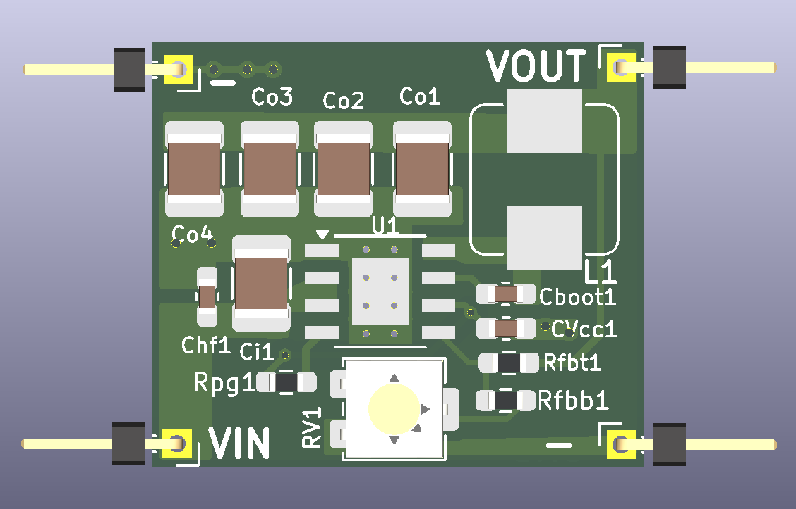

# Adjustable Synchronous Buck Converter — TI LMR33630A

A compact, two-layer adjustable DC–DC synchronous buck converter designed using the Texas Instruments LMR33630A regulator.

The design uses an adjustable feedback network to provide a nominal output adjustment range of approximately 2.67 V to 11 V.

The project was developed in KiCad and focuses on practical power-management IC selection, feedback design, component selection, two-layer PCB layout, thermal-pad implementation, and electrical-rule verification.

## 1. Features

- Texas Instruments LMR33630A synchronous buck regulator.
- Adjustable output-voltage feedback network.
- Nominal output adjustment range: approximately 2.67–11 V.
- 400 kHz nominal switching frequency.
- Integrated high-side and low-side MOSFETs.
- External power inductor and input/output filtering.
- Two-layer PCB design.
- Ground copper plane and thermal vias beneath the regulator.
- Native KiCad schematic and PCB source files.

## 2. Design Specifications

| Parameter | Design target |
|---|---|
| Main IC | TI LMR33630ADDA |
| Converter topology | Synchronous buck |
| Input voltage | 12–24 V DC |
| Output adjustment | Approximately 2.67–11 V |
| Maximum continuous output current | 2.5 A design target; not yet validated |
| Switching frequency | 400 kHz |
| PCB layers | 2 |
| Board dimensions | 22.75 × 19.75 mm |
| Regulator package | 8-pin HSOIC with exposed PowerPAD |

**Note:** The electrical limits above describe the intended design. They are not measured performance specifications.

## 3. Output Voltage Adjustment

The output voltage is programmed through the LMR33630 feedback divider.

The nominal relationship is:

\[
$V_{OUT}=V_{REF}\left(1+\frac{R_{FBT}}{R_{FBB}}\right)$
\]

Where:

- \(V_{REF}\) is the nominal 1 V feedback reference.
- \(R_{FBT}\) is the 100 kΩ upper feedback resistor.
- \(R_{FBB}\) is the series combination of a 10 kΩ resistor and the 50 kΩ trimmer.

The theoretical adjustment range is approximately 2.67–11 V.

Actual endpoints depend on component tolerances and the regulator reference accuracy.

## 4. Main Components

| Reference | Component | Manufacturer / MPN |
|---|---|---|
| U1 | LMR33630A | Texas Instruments — LMR33630ADDA |
| L1 | 8.2 µH shielded inductor | Bourns — SRP7028A-8R2M |
| RV1 | 50 kΩ trimmer | Bourns — 3314J-1-503E |
| Rfbt1 | 100 kΩ resistor | Yageo |
| Rfbb1 | 10 kΩ resistor | Yageo |
| Co1–Co4 | 22 µF ceramic capacitors | KEMET |
| Ci1 | 10 µF ceramic capacitor | KEMET |
| Cboot1 | 100 nF ceramic capacitor | KEMET |
| CVcc1 | 1 µF ceramic capacitor | KEMET |
| Chf1 | 220 nF ceramic capacitor | KEMET |

See `Documentation/DCBuck_LMR33630_BOM.csv` for the complete component list and datasheet links.

## 5. PCB Information

- PCB layers: 2
- Board thickness: 1.6 mm
- Board dimensions: 22.75 × 19.75 mm
- Component-side routing: F.Cu
- Ground reference plane: B.Cu
- Thermal connection: exposed regulator pad and thermal vias

The copper weight and final fabrication stack-up must be specified by the selected PCB manufacturer before fabrication.

## 6. Design Verification

**ERC**

- Errors: 0
- Warnings: 0

**DRC**

- Unconnected pads: 0
- Footprint errors: 0
- Eight silkscreen-to-board-edge warnings in the included report.

Reports are included in the Documentation folder and should be regenerated after any design changes.

## 7. Simulation and Hardware Testing Status

The official TI simulation model has not yet been successfully integrated into the KiCad/ngspice simulation workflow.

No simulation results or physical measurement results are claimed in this release.

The design is therefore an educational PCB design submission, not a physically validated or production-qualified power converter.

## 8. Limitations and Future Improvements

- Complete and document the manufacturer-model SPICE simulation.
- Verify output-voltage regulation across the full input and load range.
- Perform thermal analysis of the regulator and inductor.
- Investigate switching-node EMI and transient behavior.
- Verify the actual effective ceramic capacitance under DC bias.
- Perform physical prototype testing before claiming continuous-output performance.

## 9. References

- [Texas Instruments — LMR33630 Product Page](https://www.ti.com/product/LMR33630)
- [LMR33630 Datasheet](https://www.ti.com/lit/ds/symlink/lmr33630.pdf)
- [KiCad](https://www.kicad.org/)

## 10. License

Copyright © 2026 Md Tariqul Islam

The hardware design files are intended to be released under CERN Open Hardware Licence Version 2 — Strongly Reciprocal (CERN-OHL-S-2.0).

See the root `LICENSE` file for the complete licence text.